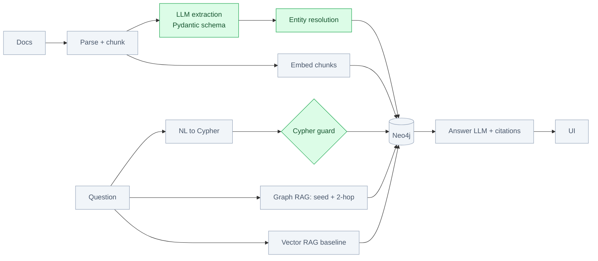

# Document Knowledge Graph QA

Turn unstructured documents into a Neo4j knowledge graph where **every edge traces back to a source chunk**, then answer multi-hop questions with graph RAG and compare against plain vector RAG.


> **Status: early skeleton, not a working pipeline.** The graph schema, entity resolution and a read-only Cypher guard are implemented and tested (5 unit tests). Extraction, loading, question answering, the Airflow DAG, the UI and the evaluation runner are **not built yet**, so there are **no accuracy, latency or cost numbers**. See [Status and findings](#status-and-findings).

## The problem

Plain vector RAG retrieves similar chunks. It fails when the answer needs facts spread over several documents:

> *"Which products are affected by finding F-12?"*

- `audit_report.md` page 2: F-12 affects **Ripstop-40**.
- `product_spec.md` pages 1 and 2: the **Alpine Shell Jacket** and the **Trail Pack 28** use Ripstop-40.

No single chunk contains both facts. A graph does: `Finding -AFFECTS-> Material <-USES- Product`.

## Architecture

Green boxes exist in this repository; grey boxes are planned.



A picture version of the target design is in `docs/architecture.svg`. Only the schema (the extraction contract), entity resolution and the Cypher guard are code today.

### Worked example (hand-written, in `data/extracted/graph_sample.json`)

```
(Finding F-12) -AFFECTS-> (Ripstop-40) <-USES- (Alpine Shell Jacket)
                                       <-USES- (Trail Pack 28)
```

The query a Text-to-Cypher step would need to produce, and which passes the guard (read-only, known relations):

```cypher
MATCH (f:Entity {name:'Finding F-12'})-[:AFFECTS]->(m:Entity)<-[:USES]-(p:Entity {type:'Product'})
RETURN p.name, collect(DISTINCT m.name) AS via
```

## What is implemented

| Piece | File | What it does |
|---|---|---|
| Schema | `src/docgraph/schema.py` | 6 entity types and 8 relations as Pydantic models. An `Edge` **requires** `doc`, `page`, `chunk_id` and a confidence in [0, 1], so provenance cannot be left out. |
| Entity resolution | `src/docgraph/resolve.py` | Normalises names (lower case, strips legal suffixes such as AG, GmbH, s.r.o., Inc, Ltd) and merges same-type entities with an equal normalised name or alias, keeping all names as aliases. A site and a company with the same name are not merged because their types differ. Exact match only. |
| Cypher guard | `src/docgraph/cypher_guard.py` | Rejects queries containing `CREATE`, `MERGE`, `DELETE`, `DETACH`, `SET`, `REMOVE`, `DROP`, `LOAD` or `CALL`, and any relation type outside the schema. |

Sample data: three **fictional** documents in `data/docs/` (a supplier agreement, a product specification and a quality audit), and 5 hand-written questions of one to three hops with gold answers in `eval/questions.jsonl`.

## Quickstart

```bash
pip install -e ".[dev]"
make test            # ruff + 5 unit tests, no services needed
make run             # starts Neo4j only (set NEO4J_PASSWORD in .env first)
```

## Planned work

- [ ] Parse and chunk documents with page and chunk ids
- [ ] LLM extraction into the schema, with retries on invalid output
- [ ] Idempotent loader (`MERGE` by deterministic id) that rejects edges without provenance
- [ ] Fuzzy entity resolution (embedding similarity and an LLM tie-break for cases like "KT")
- [ ] Text-to-Cypher, with the guard plus an `EXPLAIN` check against Neo4j
- [ ] Graph RAG and a plain vector RAG baseline, compared on multi-hop questions
- [ ] Airflow DAG, Streamlit UI and an evaluation runner with recorded results

## Status and findings

Checked on 2026-10-30:

- **Tests:** 5 unit tests pass (merge by alias and suffix, no merge between a site and a company, read query passes the guard, write and unknown relations are rejected). `ruff check` passes.
- **Fixed while preparing this repository:**
  - The original README described a 60-question evaluation with results, Airflow and UI services, and a label whitelist and `EXPLAIN` in the validator. None of these exist, so they were removed.
  - `make eval` pointed at a runner module that does not exist, so the target was removed.
  - CI would have installed Neo4j, Anthropic, Streamlit and pyvis just to run tests that need only Pydantic. Those are now an optional `app` extra.
- **Known limits of the guard:** it is keyword based, so it can reject a harmless query that mentions a word like `SET`, and it does not check node labels.
- **Not run:** anything against Neo4j or an LLM.

## References

Inspiration only, not checked for licence or activity: microsoft/graphrag and neo4j-labs/llm-graph-builder.

## License

[MIT](LICENSE)
